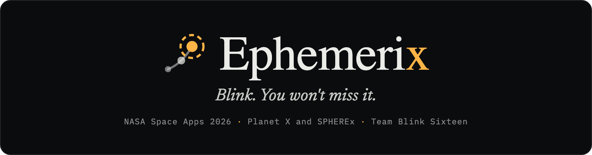
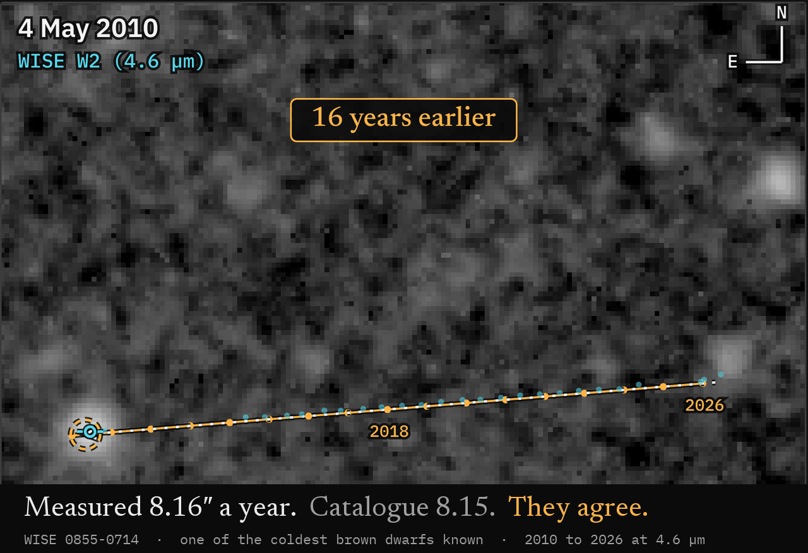
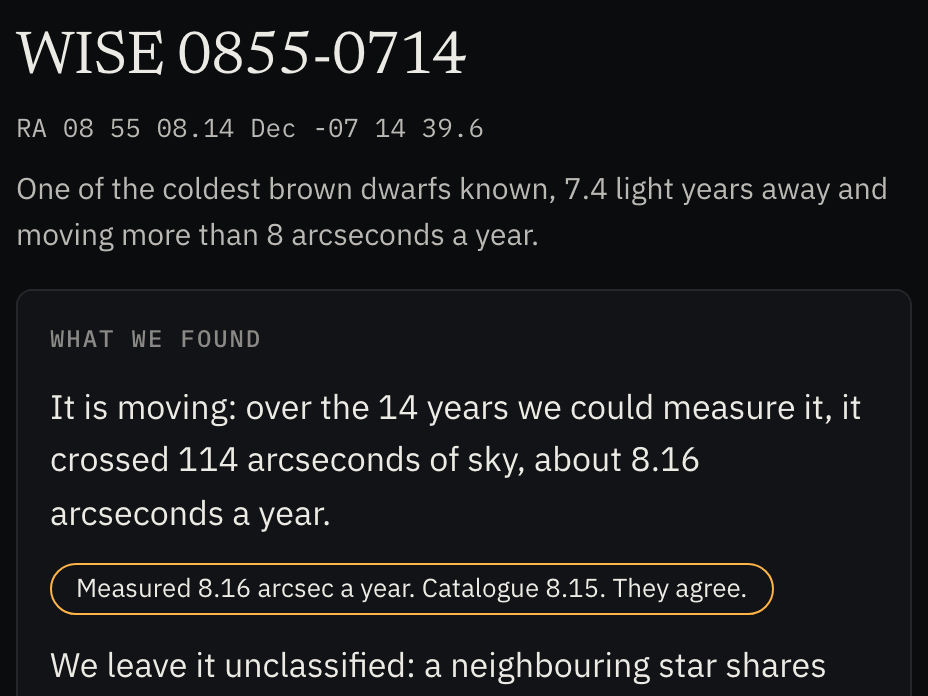
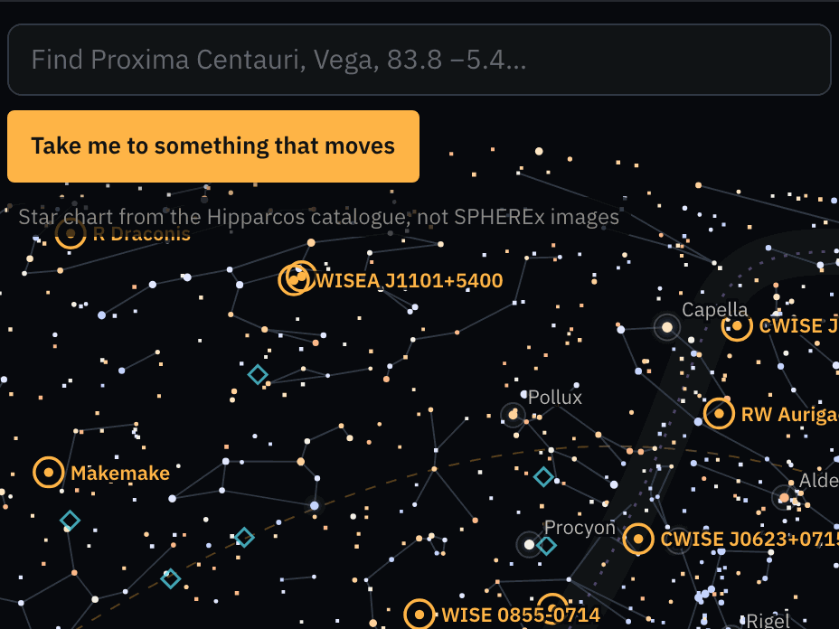
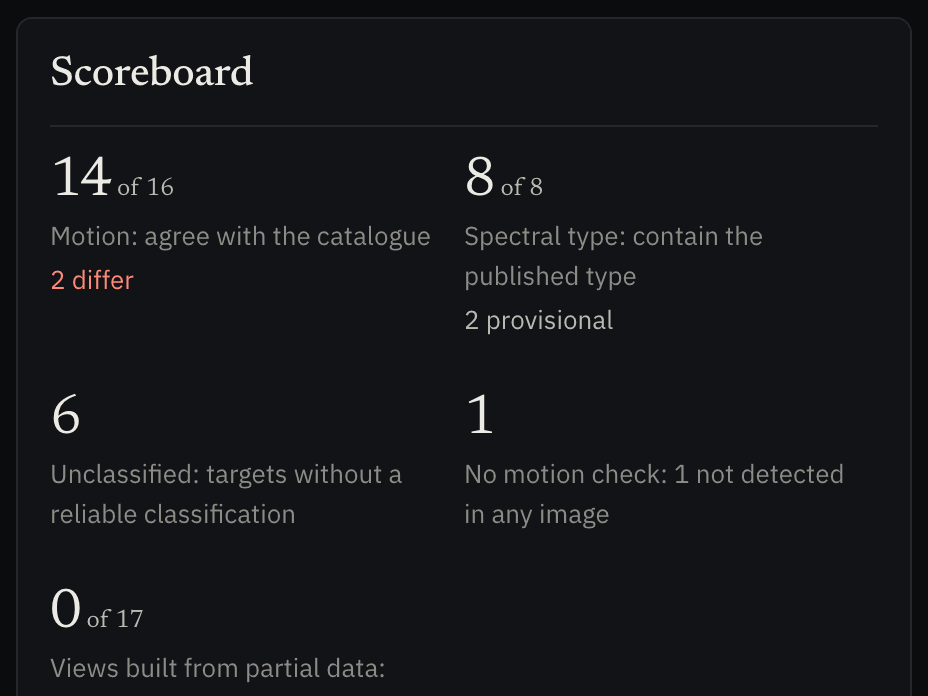
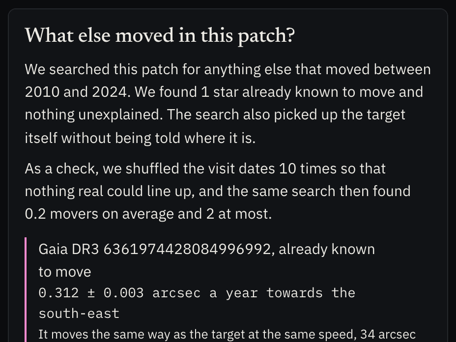
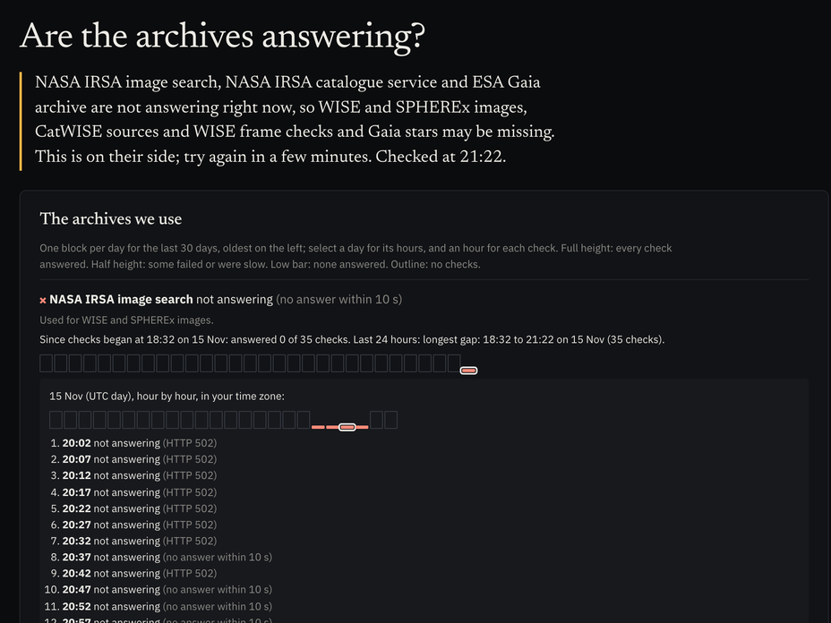
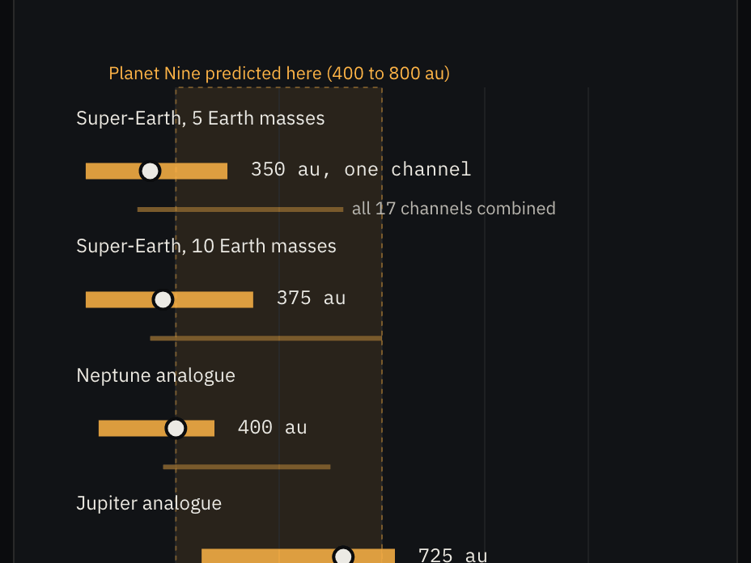

<p align="center">
  <a href="https://ephemerix.vercel.app"></a>
</p>

<p align="center">
  Ephemerix blinks 16 years of infrared sky for any position you type<br>
  and shows its measured motion next to the published one.
</p>

<p align="center">
  <a href="https://ephemerix.vercel.app"><kbd>&nbsp;<b>Open the site</b>&nbsp;</kbd></a>
  &nbsp;&nbsp;
  <a href="https://youtu.be/nYxze1vEVAE"><kbd>&nbsp;Demo video, 30 s&nbsp;</kbd></a>
  &nbsp;&nbsp;
  <a href="https://github.com/Unluckyathecking/Ephemerix"><kbd>&nbsp;Code&nbsp;</kbd></a>
</p>

<br>

<p align="center">
  <a href="https://ephemerix.vercel.app/?target=wise-0855-0714&mode=simple"></a>
</p>

<br>

**Is that dot moving, and what is it?** Of 16 measured motions, 14 agree with the published ones, and the 2 that do not are on the page.

## Who it is for

<table>
  <tr>
    <th width="33%">Backyard Worlds volunteers</th>
    <th width="33%">Students and the curious</th>
    <th width="33%">Astronomers</th>
  </tr>
  <tr>
    <td valign="top">Is the moving dot real? A summary ready to post on Talk.</td>
    <td valign="top">Simple mode: a large blink and a short answer.</td>
    <td valign="top">Advanced mode: every measurement behind it.</td>
  </tr>
</table>

> The brief notes that most known brown dwarfs "were discovered by volunteers" comparing images taken at different times, and that "no one person can sift through all that data alone".

## Try it in a minute

1. **[WISE 0855-0714](https://ephemerix.vercel.app/?target=wise-0855-0714&mode=simple).** 8.156 arcsec a year against the catalogue's 8.152.
2. **[R Draconis](https://ephemerix.vercel.app/?target=r-draconis).** The brief's variable star through its 246-day cycle. Its centre saturates, so we measure the light around it, a form of the wing photometry that a navigator's reply on the Space Apps discussion board called "optional extra credit" ([#2282](https://github.com/nasa/spaceapps/discussions/2282)); the page states its method and which bands held. [RW Aurigae A](https://ephemerix.vercel.app/?target=rw-aurigae) fades by about 1.7 times in a year at 3.8 to 5.0 microns.
3. **[Haumea](https://ephemerix.vercel.app/?target=haumea).** A dwarf planet followed along its orbit, with water ice in its spectrum. [Makemake](https://ephemerix.vercel.app/?target=makemake) shows methane.
4. **[CWISE J2029-7910](https://ephemerix.vercel.app/?target=cwise-2029-7910).** Its known host star, re-found by the blind search.

<table>
  <tr>
    <td width="50%" align="center"><a href="https://ephemerix.vercel.app/?target=wise-0855-0714&mode=simple"></a><br><sub><b>Simple mode</b>: a two-sentence answer</sub></td>
    <td width="50%" align="center"><a href="https://ephemerix.vercel.app/explore.html"></a><br><sub><b>Sky map</b>: tap a marked object</sub></td>
  </tr>
  <tr>
    <td width="50%" align="center"><a href="https://ephemerix.vercel.app/validation.html"></a><br><sub><b>Results</b>: ours against the published values</sub></td>
    <td width="50%" align="center"><a href="https://ephemerix.vercel.app/?target=cwise-2029-7910"></a><br><sub><b>Blind search</b>: the known host star, re-found</sub></td>
  </tr>
  <tr>
    <td width="50%" align="center"><a href="https://ephemerix.vercel.app/status.html"></a><br><sub><b>Status page</b>: when the archives are down</sub></td>
    <td width="50%" align="center"><a href="https://ephemerix.vercel.app/planetx.html"></a><br><sub><b>Planet X</b>: how far SPHEREx could see</sub></td>
  </tr>
</table>

## Why it is built this way

**Simple and Advanced.** Our first version was dense, as tools made for astronomers tend to be; our test was whether someone who has never seen an infrared image could get the answer. One switch on every page: Simple gives a large blink, a two-sentence answer and "What am I looking at?"; Advanced shows every measurement, band, overlay and data-quality note. A link keeps its mode.

**Any position, live.** A volunteer's new candidate is by definition in nobody's prepared gallery. The search box takes coordinates in any common format, in degrees or hours, such as the brief's `08h55m10.831s, -7d14m42.53s`, or a name. Names are suggested as you type from the site's own list of 53 SIMBAD objects with their positions and motions, so prepared views open at once; any other name goes to CDS Sesame, and a Solar System body to JPL's Small-Body Database, with its position from JPL Horizons. The view is then built from WISE, NEOWISE and SPHEREx images from NASA's IRSA archive or its public cloud copies, with stars from ESA Gaia and CatWISE (NOIRLab as a second source). In one run Luhman 16, with no prepared view, took 82 s.

**The sky map.** Most people do not carry coordinates in their head. The [map](https://ephemerix.vercel.app/explore.html) is 8,876 Hipparcos stars you can drag and zoom, with our views and nearby known objects marked. Tap one to open it, or press "Take me to something that moves"; "Back to the sky map" returns you where you left off.

### Archive uptime

Every search depends on nine public services, which we do not control. During the event they failed on and off, so a result could come back incomplete with no way to tell whose fault it was.

Others saw the same: on 14 and 15 November nine threads on the Space Apps discussion board reported IRSA returning errors or down ([#2183](https://github.com/nasa/spaceapps/discussions/2183), [#2208](https://github.com/nasa/spaceapps/discussions/2208), [#2218](https://github.com/nasa/spaceapps/discussions/2218), [#2224](https://github.com/nasa/spaceapps/discussions/2224), [#2237](https://github.com/nasa/spaceapps/discussions/2237), [#2245](https://github.com/nasa/spaceapps/discussions/2245), [#2249](https://github.com/nasa/spaceapps/discussions/2249), [#2257](https://github.com/nasa/spaceapps/discussions/2257), [#2285](https://github.com/nasa/spaceapps/discussions/2285)); the organisers acknowledged in [#2224](https://github.com/nasa/spaceapps/discussions/2224) that "some parts of the IRSA website are experiencing difficulties". Our own search of public GitHub commits and issues from 13 to 15 November found dozens of other repositories working around IRSA errors. Our status checks on 15 November, from 18:32 to 19:37 GMT, found NASA IRSA's image search answering none of 14.

Most web services have an independent status page; for the astronomy archives a tool like this depends on, we found no such browsable record, so we built one for these nine, open to anyone building on them. Every 5 minutes our server asks each of them one light question and keeps 30 days of answers. A row of marks by the search box shows which are answering now; the [status page](https://ephemerix.vercel.app/status.html) opens any day, then any hour, down to each check; and a view that is missing something names the archive that did not answer.

It also works around an outage: when NASA's image search is down, WISE frames come from the public cloud copy. On the live site at 19:41 GMT on 15 Nov, with IRSA's image search and ESA's Gaia archive both not answering, a live lookup of Betelgeuse still returned 46 WISE and 18 SPHEREx images and said its star markers were missing because Gaia was down.

**Behind each answer:** a blind search of each patch, rerun on shuffled dates to count false alarms; one grid for both missions, each spectrum read where the object was; no type the data cannot support.

## How it answers the brief

<details>
<summary>Each request in the brief, where to see it, and where the code is</summary>

| The brief asks | Where to see it |
|---|---|
| "Enter the coordinates", play "like a little video" | [WISE 0855 by coordinates](https://ephemerix.vercel.app/?ra=133.79513&dec=-7.24515) |
| Test on the five named targets | [Results page](https://ephemerix.vercel.app/validation.html) |
| "Easy to update with the latest data releases" | Every footer: SPHEREx DR1 and QR3 to 5 Oct 2026, 1,628,229 frames |
| "Display those 102 infrared bands", "six detector arrays" | [All SPHEREx bands](https://ephemerix.vercel.app/?target=2mass-0415-0935&preset=spherex-all), [methane false colour](https://ephemerix.vercel.app/?target=2mass-0415-0935&fc=1) |
| "Generate spectra on the fly" | Any typed position |
| "Add together or subtract images" | [2010 minus 2024](https://ephemerix.vercel.app/?target=wise-0855-0714&cmp=diff&a=wise-w2-2010a&b=wise-w2-2024a) |
| "Let users choose the field of view" | [2 to 8 arcmin](https://ephemerix.vercel.app/?ra=133.79513&dec=-7.24515&fov=480) |
| "Overlay ... Gaia ... or WISE" | "Gaia stars" and "CatWISE sources" toggles |
| "Coordinates in the URL ... embed it" | [Embedded view](https://ephemerix.vercel.app/?target=wise-0855-0714&embed=1) |
| "Display metadata, like contamination flags" | Plain-word notes in every view |


| The brief asks | What we do | Code |
|---|---|---|
| Coordinates, little video | Positions read at each exposure's date; RA/Dec in any common format or one of 53 SIMBAD names; images play in date order on one grid | `web/js/search.js`, `web/js/player.js`, `src/pxs/build.py` |
| Five named targets | Motion checked for all five; relative brightness over time for RW Aurigae and R Draconis | `web/js/variability.js`, `src/pxs/validation/` |
| Data releases | A new release is one entry in `COLLECTIONS` and two commands (below) | `tools/spherex_index/`, `tools/data_status.py` |
| 102 bands, six arrays | One stack per detector array per visit, a toggle per set, a methane false-colour view | `web/js/framesets.js`, `web/js/falsecolour.js` |
| Spectra on the fly | Built for any position | `src/pxs/spectra.py` |
| Add or subtract | Difference or sum of any two frames | `web/js/compare.js` |
| Field of view | 2 to 8 arcmin; wider fields are not offered | `src/pxs/api/params.py` |
| Overlays | Gaia DR3 and CatWISE2020 sources moved to each frame's date; WISE as images | `web/js/overlays.js` |
| URL and embed | `ra`, `dec`, `fov`, `target`, `cmp`, `bands`, `mode`, `embed=1` | `web/js/urlstate.js`, `docs/api.md` |
| Metadata | Saturation, after-images, blends and flagged pixels; pixels with no usable data are hatched | `web/js/flags.js` |
| Public tools such as Astropy and Aladin | Astropy, reproject and PyVO. Instead of Aladin, our own chart of 8,876 Hipparcos stars, so the page loads nothing from other hosts | `web/js/explore.js`, `pyproject.toml` |
| Archive health | Nine archive services probed every 5 minutes, 30 days kept | `src/pxs/api/archivestatus.py`, `src/pxs/archivehistory.py`, `web/status.html` |

</details>

## Results

17 objects with published values: the brief's five, seven Backyard Worlds brown dwarfs, five benchmarks. Agreement means within 3 sigma of our fit error.

| Check | Result |
|---|---|
| Motion | 14 of 16 agree, 2 differ; 1 not detected |
| Spectral type | 8 of 8 contain the published type, 2 of them provisional; one more, faint and open-ended, is counted apart; 6 unclassified |
| Blind search of each patch | Target found in 11 of 17; no unexplained tracks |
| Known Solar System bodies | 66 of 103 recovered |
| [Slow-mover search](https://ephemerix.vercel.app/search.html), 12 fields | 50% complete at 68 microjansky; nothing above noise in the 10 non-control fields |

[The results page](https://ephemerix.vercel.app/validation.html) also lists each choice we made after seeing data.

<details>
<summary>All 17 objects</summary>

For R Draconis and RW Aurigae, which barely move, agreement is a weak test: it shows we measure no false motion, since their catalogue motion is under three times our error.

| Object | Motion, ours / catalogue (arcsec/yr) | Motion | Type, ours / published | Note |
|---|---|---|---|---|
| Barnard's Star | 10.41 / 10.39 | agrees | none / M4 | saturates SPHEREx |
| Epsilon Indi B | 4.71 / 4.68 | differs, 7.1 sigma | T1 to T3 / T1 to T1.5 + T6 | unresolved pair |
| WISE 0855-0714 | 8.156 / 8.152 | agrees | unclassified / Y4 | Gaia star in the pixel |
| RW Aurigae A | 0.034 / 0.028 | agrees | unclassified / K1 to K5 | 5 usable points; fading shown |
| R Draconis | 0.025 / 0.022 | agrees | none / M4.5 to M6 | saturates; cycle shown |
| WISEA J1101+5400 | 0.741 / 0.718 | agrees | T5 to T7 / T5.5 | |
| CWISE J0623+0715 | 0.899 / 0.98 | agrees | unclassified / sdT3 | all-images fit; brighter neighbour |
| CWISE J2112-0529 | 0.833 / 0.932 | agrees | T0 to T2 / sdT1 | provisional: neighbour's light |
| CWISE J2021+1524 | not detected / 0.703 | | unclassified / d/sdL9 | not found in any image |
| CWISE J0411+4714 | 0.442 / 0.463 | agrees | unclassified / d/sdT7.5 | all-images fit |
| CWISE J2029-7910 | 0.309 / 0.304 | agrees | L0 to L2 / L1 | |
| CWISE J1055+5443 | 1.554 / 1.535 | differs, 3.0 sigma | T8 to Y1 or colder / Y0 | faint type, counted apart |
| DENIS J0255-4700 | 1.160 / 1.154 | agrees | L8 to T0 / L9 | |
| 2MASS J0559-1404 | 0.665 / 0.664 | agrees | T3 to T5 / T4.5 | |
| 2MASS J0415-0935 | 2.284 / 2.278 | agrees | T7 to T9 / T8 | |
| UGPS J0722-0540 | 0.98 / 0.97 | agrees | T8 to Y0 / T9 | provisional: neighbour's light |
| WISE 1541-2250 | 0.91 / 0.907 | agrees | unclassified / Y1 | brighter source 2 arcsec away |

The two differing motions are off by 42.4 mas/yr (Epsilon Indi B) and 29.9 mas/yr (CWISE J1055+5443) in declination. Types are a guide, given as a range one to two subtypes either side, tested from L1 to Y0.

</details>

## What we do not claim

- **Two motions disagree.** Epsilon Indi B is an unresolved pair. For CWISE J1055+5443, fitting a neighbour removed about 10 of an original 40 mas/yr miss; the rest is not explained.
- **Six objects have no type**, each with its reason on the page. Two more, Barnard's Star and R Draconis, saturate SPHEREx.
- **A denoiser failed.** We tested a denoising filter against a pass mark set in advance. It failed and is not used.
- **No Planet X.** It is predicted at 400 to 800 au; one SPHEREx map reaches a 10-Earth-mass planet to about 375 au, and our [pilot search](https://ephemerix.vercel.app/planetx.html) is far too shallow.

## Run it

The site is plain JavaScript with no build step. Serve it and open http://localhost:8765/:

```
python3 -m http.server 8765 --directory web
```

<details>
<summary>Build views, run the tests, rebuild the published numbers</summary>

A Python package, `pxs` (Astropy, reproject, PyVO), measures each view and runs the lookup service. Building views needs Python 3.11+, [uv](https://docs.astral.sh/uv/) and network access:

```
uv sync
uv run python -m pxs.build --target 2mass-0415-0935 --out build/gallery
uv run pytest
cd web && node --test tests/*.test.js
```

To rebuild the published numbers, rebuild every view, then the results file `web/data/validation.json`:

```
uv run python -m pxs.build --all
uv run python -m pxs.validation.report
```

</details>

<details>
<summary>The lookup service, new data releases and repository layout</summary>

The lookup service: `docker build -t pxs-api .`, then `docker run -p 8000:8000 -e PXS_ALLOWED_ORIGINS=http://localhost:8765 pxs-api`, and open http://localhost:8765/?api=http://localhost:8000 after allowing that origin in the page's Content-Security-Policy (see `web/js/config.js`). Without `PXS_SPHEREX_INDEX` it uses IRSA's search. `deploy/modal_app.py` is our own deployment and will not run unchanged.

A new SPHEREx release: add it to `COLLECTIONS`, then `modal run tools/spherex_index/modal_index.py && uv run python tools/data_status.py`.

Without `--out` the build writes into `web/gallery`; the view format is in `docs/api.md`.

Layout: `web/` site and gallery, `src/pxs/` measurements and lookup service, `tools/` index and campaigns (`denoise/` unused), `probes/` exploration scripts, including the variable-star analysis.

</details>

## Credits

Images and catalogues from NASA/IPAC IRSA, ESA Gaia DR3, JPL, CDS and Hipparcos; code under MIT.

<details>
<summary>Full credits and licences</summary>

Our code is MIT licensed (`LICENSE`). Plotly.js 2.35.2 (MIT) and the typefaces Newsreader, IBM Plex Sans and IBM Plex Mono (SIL Open Font License) are in `web/vendor/` with their licences.

- SPHEREx, WISE and NEOWISE images and CatWISE2020 from the NASA/IPAC Infrared Science Archive (IRSA) and its public cloud buckets; JPL Horizons and the Small-Body Database.
- ESA Gaia DR3 (ESA/Gaia/DPAC), also through NOIRLab Astro Data Lab; CDS Sesame and SIMBAD, also for the name index; AAVSO VSX for R Draconis's period.
- Hipparcos (ESA 1997) for the star chart; constellation lines and names from Stellarium's "modern" sky culture, CC BY-SA 4.0.
- SPIFF templates, Gagne et al., arXiv:2604.22012, Zenodo 10.5281/zenodo.19051216, CC BY 4.0, unchanged in `data/templates/spiff/` (see `ATTRIBUTION.md` there).
- The Brown and Batygin 2021 Planet Nine reference population and the CALSPEC solar spectrum (STScI). The Planet X literature is listed on the site's Planet X page.

</details>

Not an official NASA or ESA product.

## Use of AI

Before the event I used Claude to research the challenge and the SPHEREx and WISE archives and to brainstorm approaches, and I chose the direction from that. No project code was written before the hackathon began. During the event, AI agents wrote most of the code and ran the measurement campaigns under my direction. I set the goals and made the product decisions, and I decided what was good enough to publish.

The code in this repository was written with Claude Code, as the Space Apps rules ask us to acknowledge.

## Next

Measure how Epsilon Indi B's 4.6 micron light splits between its two brown dwarfs, and write RW Aurigae's pass and fail tests before looking at new data.
